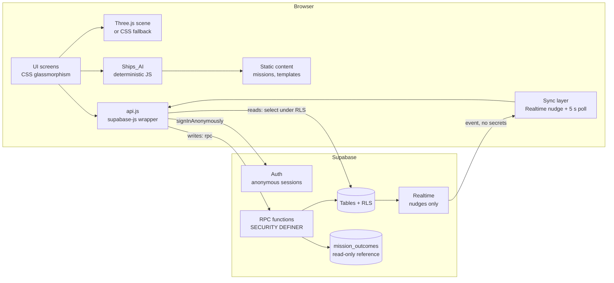
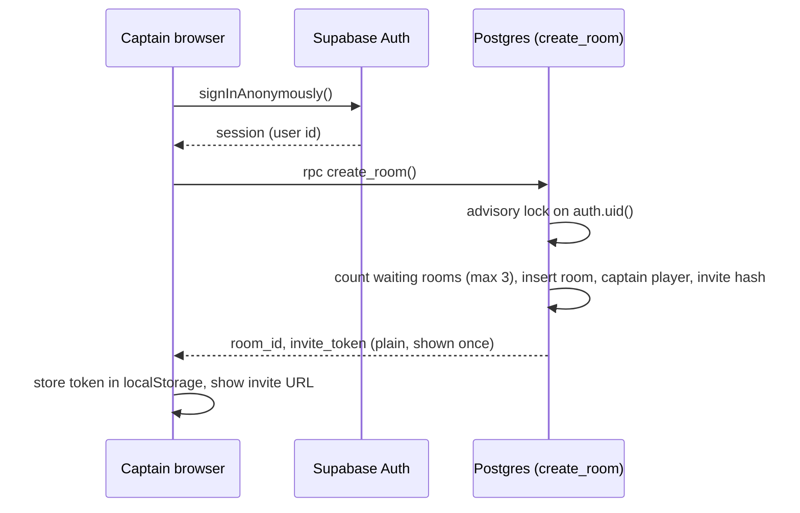
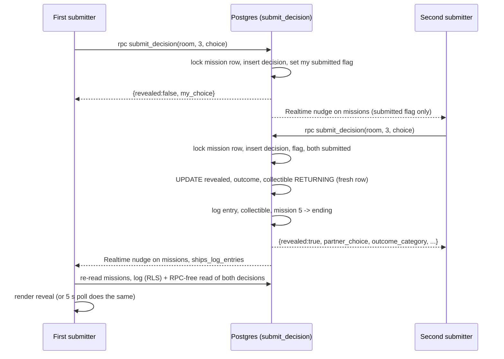
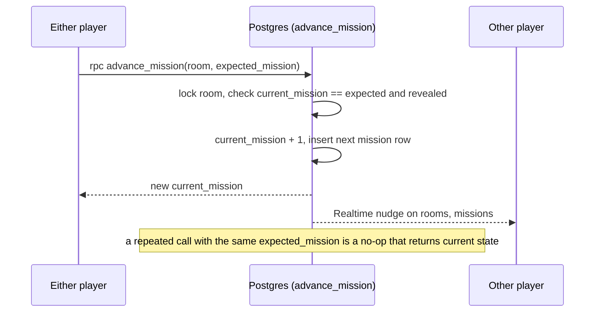
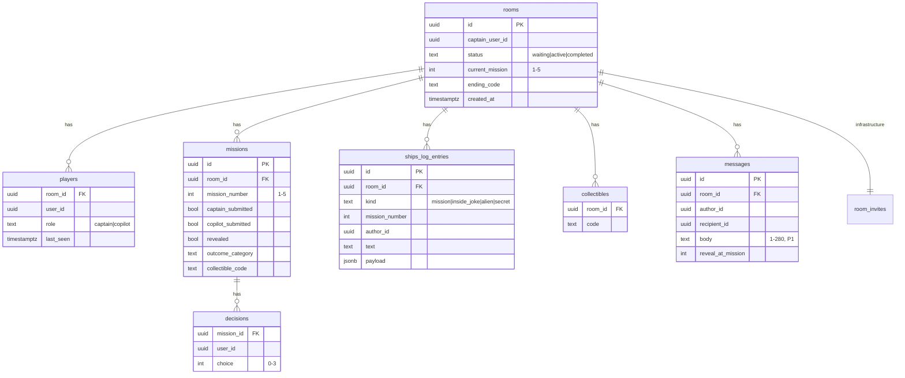
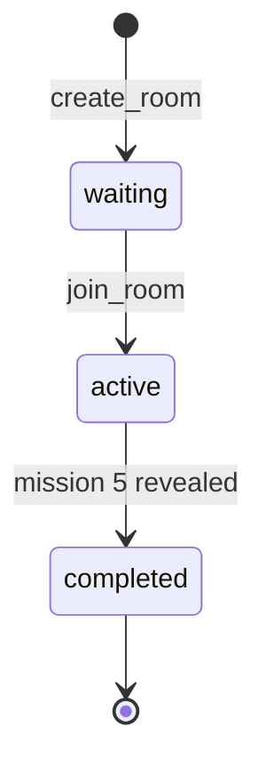
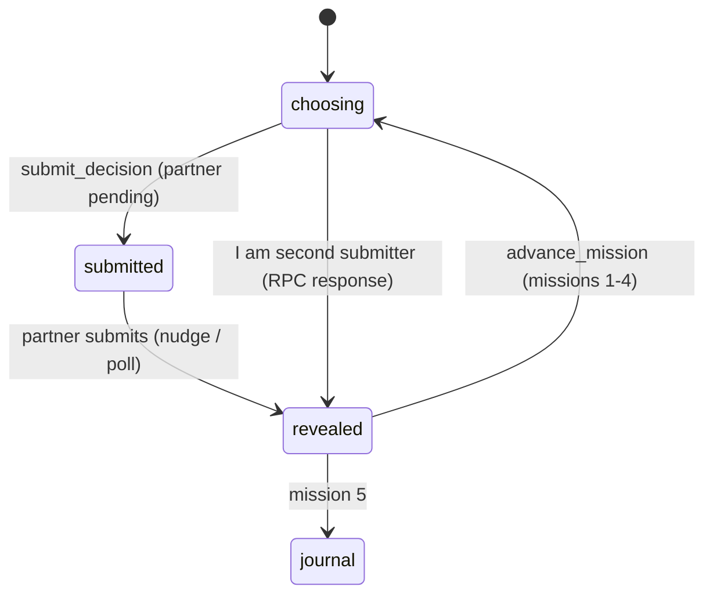

# Design Document

## Overview

**TWO STRANGERS, ONE SPACESHIP** is a static website (HTML, CSS, vanilla JavaScript ES modules, Three.js) that talks to one Supabase project. Two players on different devices share a private Room, secretly pick one of four Decisions per Mission, and see both choices revealed together. Five Missions, then an Adventure_Journal.

The design follows one rule: **the browser is untrusted; the database decides.** The browser can read only what Row Level Security (RLS) allows. It cannot insert, update or delete any table. Every write goes through a small set of Postgres functions (RPCs) that check who is calling, which room they mean, and what state the room is in.

### Fixed stack

| Part | Choice |
| --- | --- |
| Front end | HTML, CSS, vanilla JS ES modules. No build step, no framework. |
| 3D | Three.js, pinned version, loaded from a CDN through an import map. Built-in materials only. |
| Back end | Supabase: anonymous auth, Postgres, RLS, `SECURITY DEFINER` RPCs, Realtime. |
| Supabase client | `@supabase/supabase-js`, pinned version, CDN ES module through the same import map. |
| Hosting | GitHub Pages (static files). |
| Dev-only tests | `node --test` and `fast-check`. Never shipped to the browser. |
| Not used | Edge Functions, bundlers, custom shaders, physics engines, external or paid LLM APIs. |

P2 items are excluded. P1 features live in `js/p1/` and in clearly marked SQL blocks (`-- P1 BEGIN` / `-- P1 END`) so each one can be dropped without touching P0 code.

## Architecture



## File Structure

```
index.html              entry page, import map (Three.js, supabase-js pinned)
config.example.js       committed placeholders: SUPABASE_URL, SUPABASE_ANON_KEY
config.js               git-ignored locally; committed only on the deploy branch
.gitignore              lists config.js
css/
  base.css              palette, typography, focus styles, 44px controls
  glass.css             glassmorphism panels, transitions (<= 1 s)
  fallback.css          Fallback_Presentation (static gradient scene)
js/
  main.js               boot, router (hash based), screen switching
  api.js                supabase client, rpc wrappers, error mapping
  session.js            anonymous sign-in, restore, one silent refresh
  sync.js               Realtime subscriptions + 5 s polling + connection status
  state.js              in-memory room state, derived from reads
  content/
    missions.js         5 missions: intro, 4 options, consequence text per pair
    outcomes.js         JS copy of the 80-row outcome mapping (tested == SQL)
    endings.js          four endings text
    ai_templates.js     Ships_AI templates (>= 3 per outcome category)
    collectibles.js     six collectibles
  ai/
    ships_ai.js         seeded PRNG, history replay, comment selection
  journal.js            builds Adventure_Journal from log entries
  validate.js           inside-joke length validator (1-140)
  render.js             plain-text helpers (textContent only)
  scene/
    scene.js            single renderer, loop, pause on hidden tab
    starfield.js        Points
    nebula.js           canvas-texture sprites
    planet.js           one mesh, palette swap per mission
    ship.js             primitives
    capability.js       WebGL detection, device tier, reduced motion
  p1/                   (each file droppable)
    alien.js
    secret_messages.js
    easter_eggs.js
    joke_callbacks.js
    journal_export.js
sql/
  01_schema.sql         tables, constraints, indexes
  02_rls.sql            RLS enable, policies, is_room_member, grants
  03_rpc.sql            RPC functions and grants
  04_compute_ending.sql
  seed_outcomes.sql     80 rows of mission_outcomes
  p1_features.sql       P1 BEGIN/END blocks: secret messages, alien
tests/                  dev only
  unit/                 node --test + fast-check
  sql/                  RLS and RPC tests
  attack/               two-session attack script
docs/SETUP.md           Supabase and GitHub Pages steps (Req 13.6)
```

## Identity, Sessions and Invitations

`auth.uid()` is the only identity the server trusts. The browser never sends a user id.

- On first visit the browser calls `signInAnonymously()`. supabase-js stores the session in `localStorage`, so refresh and return on the same device restore the same user (Req 4.2, 4.3).
- The **room URL** carries the room id: `#/room/<room_id>`. The **invite URL** carries the token only: `#/join/<token>`. The server resolves the room from the token's hash, so the browser never sends a room id when joining.
- The invite token is 16 random bytes from `gen_random_bytes(16)` (128 bits), encoded as hex. Only its SHA-256 hash is stored, in `room_invites`. The Captain's browser keeps the plain token in `localStorage` so the invite link can be shown again.
- Expired session: one silent `refreshSession()`. If it fails, show the rejoin message (Req 15.4).
- v1 limitation: a new device or cleared storage gets a new anonymous user. That user can enter only through an invite while a seat is free. There is no account recovery.

### Create room



### Join room

```mermaid
sequenceDiagram
  participant P as Co-Pilot browser
  participant A as Supabase Auth
  participant DB as Postgres (join_room)
  participant C as Captain browser
  P->>A: signInAnonymously()
  P->>DB: rpc join_room(token)
  DB->>DB: validate token format, sha256, look up room_invites by hash -> room_id
  DB->>DB: lock resolved room row; if caller already a member return {room_id, role}
  DB->>DB: room must be waiting, seat free
  DB->>DB: insert copilot player, room status = active, create mission 1
  DB-->>P: {room_id, role: copilot}
  DB-->>C: Realtime nudge on rooms and players
  C->>DB: select rooms, players (RLS)
  C->>C: show both players present
```

### Submit and reveal (both submitters)



The first submitter learns of the reveal from the nudge and a re-read, or at the latest from the 5 s poll.

### Advance mission



### Disconnect and return

```mermaid
sequenceDiagram
  participant P as Player browser
  participant DB as Postgres
  P->>P: tab closed or offline
  Note over DB: players.last_seen stops updating; partner sees "disconnected" after ~30 s
  P->>P: reopen room URL
  P->>DB: restore session (localStorage), select rooms, players, missions
  P->>DB: rpc touch_presence(room)
  P->>P: restore role, mission, submitted state (<= 3 s)
```

## Data Models

Seven gameplay entities (Req 13.4) plus one infrastructure table (`room_invites`) and one read-only reference table (`mission_outcomes`).



### SQL sketch (concise, not complete)

```sql
create table rooms (
  id uuid primary key default gen_random_uuid(),
  captain_user_id uuid not null,
  status text not null default 'waiting' check (status in ('waiting','active','completed')),
  current_mission int not null default 1 check (current_mission between 1 and 5),
  ending_code text,
  created_at timestamptz not null default now()
);

create table room_invites (            -- infrastructure, not a gameplay entity
  room_id uuid primary key references rooms(id) on delete cascade,
  invite_hash bytea not null           -- sha256 of the token
);
create unique index room_invites_hash_uq on room_invites (invite_hash);  -- join_room resolves the room by hash
alter table room_invites enable row level security;   -- no policies
revoke all on room_invites from anon, authenticated;  -- no grants

create table players (
  room_id uuid not null references rooms(id) on delete cascade,
  user_id uuid not null,
  role text not null check (role in ('captain','copilot')),
  last_seen timestamptz not null default now(),
  unique (room_id, role), unique (room_id, user_id)
);

create table missions (
  id uuid primary key default gen_random_uuid(),
  room_id uuid not null references rooms(id) on delete cascade,
  mission_number int not null check (mission_number between 1 and 5),
  captain_submitted bool not null default false,
  copilot_submitted bool not null default false,
  revealed bool not null default false,
  outcome_category text, collectible_code text,   -- null until reveal
  unique (room_id, mission_number)
);

create table decisions (
  mission_id uuid not null references missions(id) on delete cascade,
  user_id uuid not null,
  choice int not null check (choice between 0 and 3),
  unique (mission_id, user_id)
);

create table ships_log_entries (
  id uuid primary key default gen_random_uuid(),
  room_id uuid not null references rooms(id) on delete cascade,
  kind text not null check (kind in ('mission','inside_joke','alien','secret')),
  mission_number int, author_id uuid,
  text text check (char_length(text) <= 1000),
  payload jsonb,
  check (kind <> 'inside_joke' or char_length(text) between 1 and 140)
);
create unique index one_mission_entry on ships_log_entries (room_id, mission_number)
  where kind = 'mission';

create table collectibles (
  room_id uuid not null references rooms(id) on delete cascade,
  code text not null, unique (room_id, code)
);

create table messages (                -- P1 secret messages
  id uuid primary key default gen_random_uuid(),
  room_id uuid not null references rooms(id) on delete cascade,
  author_id uuid not null, recipient_id uuid not null,
  body text not null check (char_length(body) between 1 and 280),
  reveal_at_mission int not null check (reveal_at_mission between 2 and 5)
);

create table mission_outcomes (        -- read-only reference, 80 rows (seed_outcomes.sql)
  mission_number int, captain_choice int, copilot_choice int,
  outcome_category text not null
    check (outcome_category in ('harmony','chaos','standoff','mischief','blunder')),
  collectible_code text,
  primary key (mission_number, captain_choice, copilot_choice)
);
```

Notes for a beginner:
- 5 missions x 4 captain choices x 4 co-pilot choices = **80 rows**.
- `outcome_category` and `collectible_code` stay `null` until the reveal, so Realtime events on `missions` never leak anything.
- Text fields have `char_length` checks (at most 1 KB, Req 14.10).

## RLS Policies, Membership Helper and Grants

Rule: **no client INSERT, UPDATE or DELETE on any table.** Clients get `SELECT` only, filtered by RLS. Every write goes through an RPC.

### Membership helper

RLS policies run as the querying role (`authenticated`), so that role needs `EXECUTE` on the helper.

```sql
create function public.is_room_member(p_room_id uuid) returns boolean
language sql stable security definer
set search_path = public, pg_temp          -- blocks search_path hijacking
as $$ select exists (
  select 1 from public.players
  where room_id = p_room_id and user_id = auth.uid()   -- never a passed-in user id
) $$;
alter function public.is_room_member(uuid) owner to postgres;
revoke all on function public.is_room_member(uuid) from public, anon;
grant execute on function public.is_room_member(uuid) to authenticated;
```

Why `SECURITY DEFINER`: the `players` policy itself uses the helper. Without it the policy would call itself recursively.

### Default privileges warning

Supabase grants `EXECUTE` on new functions to `anon` and `authenticated` by default (default privileges in `public`). A plain `create function` is therefore callable by everyone. **Every function needs an explicit `revoke ... from public, anon` and a deliberate `grant`.** Optionally also run `alter default privileges in schema public revoke execute on functions from anon, authenticated;` so new functions start closed.

### Policies

```sql
alter table rooms, players, missions, decisions, messages,
            ships_log_entries, collectibles, mission_outcomes enable row level security;

create policy rooms_select on rooms for select to authenticated using (is_room_member(id));
create policy players_select on players for select to authenticated using (is_room_member(room_id));
create policy missions_select on missions for select to authenticated using (is_room_member(room_id));
create policy log_select on ships_log_entries for select to authenticated using (is_room_member(room_id));
create policy coll_select on collectibles for select to authenticated using (is_room_member(room_id));

-- decisions: own row always; the partner's row only after reveal
create policy decisions_select on decisions for select to authenticated using (
  user_id = auth.uid()
  or exists (select 1 from missions m
             where m.id = decisions.mission_id and m.revealed and is_room_member(m.room_id))
);

-- messages (P1): author sees own; recipient sees only once reveal_at_mission is revealed
create policy messages_select on messages for select to authenticated using (
  author_id = auth.uid()
  or (recipient_id = auth.uid() and exists (
        select 1 from missions m where m.room_id = messages.room_id
          and m.mission_number >= messages.reveal_at_mission and m.revealed))
);

-- reference data: readable, never writable
create policy outcomes_select on mission_outcomes for select to authenticated using (true);

-- table grants: SELECT only, and only to authenticated
revoke all on all tables in schema public from anon, authenticated;
grant select on rooms, players, missions, decisions, messages,
                ships_log_entries, collectibles, mission_outcomes to authenticated;
```

No `INSERT`/`UPDATE`/`DELETE` policies exist and none is granted, so those statements fail even with a valid session.

## Components and Interfaces

Front-end modules are listed in File Structure. The server-side interface is the set of RPCs below plus RLS-filtered SELECTs.

### RPC Contract Table

All RPCs are `LANGUAGE plpgsql SECURITY DEFINER SET search_path = public, pg_temp`, owned by `postgres`. Every room-specific RPC takes `p_room_id` explicitly. **The server never guesses the room from the caller's memberships**, because one user can sit in several rooms. Each RPC resolves the caller with:

```sql
select * into v_player from players where room_id = p_room_id and user_id = auth.uid();
if not found then raise exception 'not_member'; end if;
```

Common grants for every RPC below: `revoke all ... from public, anon; grant execute ... to authenticated;` unless stated otherwise.

| Signature | Caller / role check | State preconditions | Input validation | Locking | Idempotency | Errors | Grants |
| --- | --- | --- | --- | --- | --- | --- | --- |
| `create_room() returns (room_id, invite_token)` | Any authenticated user. Caller becomes Captain. | Caller owns fewer than 3 waiting rooms (technical abuse limit, pending a recorded Scope_Decision). | none | `pg_advisory_xact_lock(hashtextextended(auth.uid()::text, 0))` before the count and insert | Not idempotent: each call makes a new room (bounded by the limit) | `too_many_waiting_rooms` | authenticated |
| `join_room(p_token text) returns json {room_id, role}` | Any authenticated user. Becomes Co-Pilot. The room is resolved from the token, never supplied by the client. | Steps: validate token (hex, length 32) -> `digest(p_token,'sha256')` -> look up `room_invites` by `invite_hash` (unique index) to get `room_id` -> `SELECT ... FOR UPDATE` on that room. Then: caller already a member -> return `{room_id, role}` unchanged. Otherwise room `waiting` with exactly one player -> insert Co-Pilot with `user_id = auth.uid()`, set `active`, create mission 1, return `{room_id, role:'copilot'}` | Token is hex, length 32 | `FOR UPDATE` on the resolved room row | Idempotent: an existing member (a Co-Pilot refreshing, or the Captain opening their own invite, who gets role `captain`) gets `{room_id, role}` with no change | `invalid_invite` (unknown or malformed token, indistinguishable), `room_full`, `room_not_waiting` | authenticated |
| `regenerate_invite(p_room_id uuid) returns text` | Caller is the Captain of `p_room_id` | Room `waiting` | none | `FOR UPDATE` on the room row | Each call replaces the hash; only the latest token works | `not_member`, `not_captain`, `room_not_waiting` | authenticated |
| `submit_decision(p_room_id uuid, p_mission_number int, p_choice int) returns json` | Caller is a member of `p_room_id` | Room `active`; `p_mission_number = rooms.current_mission`; previous mission revealed | `p_choice` in 0..3; mission number 1..5 | `FOR UPDATE` on the mission row | Repeat call returns stored state with `already_locked: true`; the new choice is ignored | `not_member`, `room_not_active`, `wrong_mission`, `bad_choice`, `outcome_missing` (`already_locked` is a response flag, not an exception) | authenticated |
| `advance_mission(p_room_id uuid, p_expected_mission int) returns int` | Member | Room `active`; current mission == `p_expected_mission`; that mission revealed; `p_expected_mission < 5` | expected 1..4 | `FOR UPDATE` on the room row | If `current_mission` is already `p_expected_mission + 1`, return it without change | `not_member`, `not_revealed`, `wrong_mission` | authenticated |
| `add_inside_joke(p_room_id uuid, p_text text)` | Member | Room `active` or `completed`; at most 20 Inside_Jokes per player per Room (count where `room_id = p_room_id and author_id = auth.uid() and kind = 'inside_joke'`) | trimmed length 1..140 | `FOR UPDATE` on the room row (serializes the cap) | Not idempotent; each valid call adds one joke (bounded by the 20-per-player cap) | `not_member`, `bad_length`, `too_many_jokes` | authenticated |
| `touch_presence(p_room_id uuid)` | Member; updates only the caller's own `players.last_seen` | none | none | none (single-row update) | No-op if `last_seen` is less than 10 s old (technical throttle, not a gameplay rule) | `not_member` | authenticated |
| `is_room_member(p_room_id uuid)` | Helper for RLS (see above) | n/a | n/a | n/a | n/a | n/a | authenticated only |
| `compute_ending(p_room_id uuid) returns text` | Internal | Mission 5 revealed | n/a | Called inside `submit_decision` while the mission lock is held | Pure function of saved rows | n/a | `revoke all on function public.compute_ending(uuid) from public, anon, authenticated;` Owned by `postgres`, `SET search_path = public, pg_temp`. Only `submit_decision` (SECURITY DEFINER, runs as `postgres`) calls it. |
| **P1** `add_secret_message(p_room_id uuid, p_text text, p_reveal_at_mission int)` | Member; recipient is the other player | Room `active`; `p_reveal_at_mission` > current mission; max 5 per player (author) per Room | length 1..280; reveal 2..5 | `FOR UPDATE` on the room row | Not idempotent | `not_member`, `bad_length`, `bad_reveal`, `too_many_messages` | authenticated |
| **P1** `submit_alien_traits(p_room_id uuid, p_trait_codes text[])` | Member; Captain sends physical codes, Co-Pilot sends personality codes | Room `active`; no alien yet | each code in the allowed list for the caller's role | `FOR UPDATE` on the room row | A second submission from the same role is ignored; the alien is saved when both exist | `not_member`, `bad_trait` | authenticated |

### Limits and settings

- Inside_Jokes: 20 per player per Room (P0, gameplay).
- Secret_Messages: 5 per player per Room (P1, gameplay).
- Waiting rooms: 3 per Captain (technical abuse limit, to be recorded as a Scope_Decision; it does not limit gameplay within a Room).
- Heartbeat 15 s, offline after 30 s, presence throttle 10 s (technical implementation settings, not gameplay rules).

Any further gameplay restriction requires a recorded Scope_Decision.

### Waiting-room limit, concurrency safe

This 3-room limit is a technical abuse-prevention setting pending a recorded Scope_Decision.

Without a lock, two simultaneous `create_room` calls both count 2 waiting rooms, both pass, and the user ends up with 4. The fix is a transaction-scoped advisory lock keyed on the user:

```sql
perform pg_advisory_xact_lock(hashtextextended(auth.uid()::text, 0));
select count(*) into v_n from rooms where captain_user_id = auth.uid() and status = 'waiting';
if v_n >= 3 then raise exception 'too_many_waiting_rooms'; end if;
-- insert room, captain player, invite hash
```

The second call waits until the first commits, then sees the new count. The lock is released automatically at commit or rollback. **Alternative:** lock a per-user row in a `user_limits` table with `FOR UPDATE`. That works too but needs one more table and an insert-if-missing step. The advisory lock needs no table, so it is simplest.

## Server-Side Reveal and Result Derivation

The reveal happens **inside `submit_decision`**, when the second decision arrives, while the mission row is locked. There is no separate `finalize_mission` RPC, so there is no window where a client could trigger a reveal early or twice.

```sql
-- inside submit_decision, after checks
select * into v_mission from missions
  where room_id = p_room_id and mission_number = p_mission_number for update;

select user_id into v_captain_id from players where room_id = p_room_id and role = 'captain';
select user_id into v_copilot_id from players where room_id = p_room_id and role = 'copilot';

-- idempotent repeat: first decision is kept, the new p_choice is ignored
select choice into v_stored_choice from decisions
  where mission_id = v_mission.id and user_id = auth.uid();
if found then
  if v_mission.revealed then
    select choice into v_partner_choice from decisions
      where mission_id = v_mission.id and user_id <> auth.uid();
  end if;
  return json_build_object(
    'mission_number', v_mission.mission_number,
    'my_choice', v_stored_choice,             -- the STORED choice, not p_choice
    'already_locked', true,
    'revealed', v_mission.revealed,
    'outcome_category', v_mission.outcome_category,
    'collectible_code', v_mission.collectible_code,
    'ending_code', (select ending_code from rooms where id = p_room_id),
    'partner_choice', case when v_mission.revealed then v_partner_choice end);
end if;

-- unique (mission_id, user_id) is the backstop: a race raises unique_violation,
-- which the client treats as already_locked and re-reads.
insert into decisions (mission_id, user_id, choice) values (v_mission.id, auth.uid(), p_choice);

update missions set
  captain_submitted = captain_submitted or (v_player.role = 'captain'),
  copilot_submitted = copilot_submitted or (v_player.role = 'copilot')
where id = v_mission.id
returning * into v_mission;                       -- fresh row, not the pre-UPDATE variable

if v_mission.captain_submitted and v_mission.copilot_submitted
   and not v_mission.revealed
   and (select count(*) from players where room_id = p_room_id) = 2 then
  select o.* into v_out from mission_outcomes o
   join decisions dc on dc.mission_id = v_mission.id and dc.user_id = v_captain_id
   join decisions dp on dp.mission_id = v_mission.id and dp.user_id = v_copilot_id
   where o.mission_number = p_mission_number
     and o.captain_choice = dc.choice and o.copilot_choice = dp.choice;
  if not found then raise exception 'outcome_missing'; end if;   -- rolls back; nothing revealed

  update missions set revealed = true,
         outcome_category = v_out.outcome_category,
         collectible_code = v_out.collectible_code
   where id = v_mission.id
  returning * into v_mission;                     -- fresh row again

  insert into ships_log_entries (room_id, kind, mission_number, payload)
    values (p_room_id, 'mission', p_mission_number, to_jsonb(v_mission))
    on conflict do nothing;
  if v_out.collectible_code is not null then
    insert into collectibles (room_id, code) values (p_room_id, v_out.collectible_code)
      on conflict do nothing;
  end if;
  if p_mission_number = 5 then
    update rooms set ending_code = compute_ending(p_room_id), status = 'completed'
     where id = p_room_id;
  end if;
end if;

if v_mission.revealed then                        -- after the reveal UPDATE, so it reflects the commit
  select choice into v_partner_choice from decisions
    where mission_id = v_mission.id and user_id <> auth.uid();
end if;

return json_build_object(
  'mission_number', v_mission.mission_number,
  'my_choice', p_choice,
  'already_locked', false,
  'revealed', v_mission.revealed,
  'outcome_category', v_mission.outcome_category,
  'collectible_code', v_mission.collectible_code,
  'ending_code', (select ending_code from rooms where id = p_room_id),
  'partner_choice', case when v_mission.revealed then v_partner_choice end);
```

Key points:
- The return value is built from `v_mission` **after** the last `UPDATE ... RETURNING`. It reports what was actually committed, never a stale copy.
- The second submitter gets `revealed = true` in the RPC response. The first submitter finds out through the Realtime nudge on `missions` plus a re-read, or the 5 s poll.
- `partner_choice` is present only when `revealed` is true.
- A repeat call by the same player returns `already_locked: true` with the stored `my_choice`; no exception is raised. The client shows "Decision already locked" when the flag is true.
- If the outcome lookup finds no row, `outcome_missing` is raised and the transaction rolls back, so nothing is revealed.
- Only the database determines outcomes, collectibles and endings.
- `compute_ending(room_id)` is a deterministic SQL function (owned by `postgres`, `SET search_path = public, pg_temp`) over earlier `outcome_category` and `collectible_code` values. Sketch: count `harmony` outcomes and special collectibles, then pick one of four endings with fixed thresholds and a fixed tie-break order. Same history always gives the same ending.

```sql
revoke all on function public.compute_ending(uuid) from public, anon, authenticated;
```

It is invoked only from `submit_decision`, which runs `SECURITY DEFINER` as `postgres`, so internal use still works. No client can call it through RPC.
- Outcome categories: `harmony`, `chaos`, `standoff`, `mischief`, `blunder`.
- Consequence **text** is static JS keyed by `(mission, captain_choice, copilot_choice)`. The server decides the category and collectible; the client shows the matching text. A consistency test checks the JS mapping equals `seed_outcomes.sql` for all 80 pairs.

## Realtime Subscriptions

Realtime events are **nudges only**. On any event the client re-reads state through RLS `SELECT` (or an RPC response). It never trusts the event payload as the source of truth.

| Table | Filter | Events | Why safe |
| --- | --- | --- | --- |
| `rooms` | `id=eq.<room_id>` | INSERT, UPDATE | Member-only SELECT RLS. No secrets in columns. |
| `players` | `room_id=eq.<room_id>` | INSERT, UPDATE | Member-only. Carries role and `last_seen` (presence). |
| `missions` | `room_id=eq.<room_id>` | INSERT, UPDATE | Holds only submitted booleans. `outcome_category` and `collectible_code` are null until reveal. |
| `ships_log_entries` | `room_id=eq.<room_id>` | INSERT, UPDATE | Member-only. Entries appear only after reveal or by joke submission. |
| `collectibles` | `room_id=eq.<room_id>` | INSERT, UPDATE | Member-only. Added only at reveal. |

**Not in the `supabase_realtime` publication and never subscribed:** `decisions`, `messages`, `room_invites`.

```sql
alter publication supabase_realtime add table rooms, players, missions, ships_log_entries, collectibles;
-- decisions, messages, room_invites are deliberately absent
```

Polling fallback: every 5 s (or less) the client re-reads `rooms`, `players`, `missions`, `ships_log_entries`, `collectibles` for the current room. Polling runs always at low priority when Realtime reports `CHANNEL_ERROR` or `CLOSED`; it is the main path if Realtime is dropped to save effort (see Risks). Presence: the client calls `touch_presence` every 15 s; the partner is shown as disconnected when `last_seen` is older than 30 s.

## Threat Model and Bypass Table

| Attack | Control | Req 14 criterion |
| --- | --- | --- |
| SELECT the other player's decision (filtered query for their `user_id`) | `decisions_select` allows only `user_id = auth.uid()` until `missions.revealed`. Returns zero rows. | 14.3 |
| SELECT all decisions with no filter | Same policy. Only the caller's own rows come back. | 14.3 |
| Joins or views to reach decisions (e.g. join `missions` to `decisions`, or a view) | Policies apply to the underlying tables. No views are created. `missions` has no choice column. | 14.3 |
| RPC misuse: call `submit_decision` for a room you are not in | `not_member` from the `room_id AND user_id = auth.uid()` lookup. | 14.2 |
| RPC misuse: pass a `p_room_id` of a different room you do belong to, hoping for a cross-effect | Every RPC acts on the explicit room only; the mission, players and role are all looked up inside that room. Nothing is inferred from other memberships. | 14.2 |
| Subscribe to Realtime for `decisions` | Table not in the publication. Other subscribed tables hold no unrevealed data. | 14.3 |
| Write `revealed = true` directly | No UPDATE grant or policy on `missions`. | 14.4 |
| Insert a decision for the other player | No INSERT grant. In the RPC, `user_id` is always `auth.uid()`. | 14.2 |
| Update or delete own submitted decision | No UPDATE/DELETE grant. Unique `(mission_id, user_id)` backstop, and a repeat `submit_decision` returns the stored choice with `already_locked: true`. | 14.5 |
| Third player joins a full room | `join_room(token)` resolves the room from the token and requires exactly one player under the room lock; unique `(room_id, role)` is a second barrier. | 14.6 |
| Guess an invite token | 128-bit token, looked up by hash with no room id from the client. Unknown or malformed tokens all return the same `invalid_invite`. | 14.2, 14.6 |
| Read `room_invites` hash | RLS enabled, no policy, no grant to `anon` or `authenticated`. | 14.1 |
| Replay an old invite token after `regenerate_invite` | The hash row is overwritten under lock; the old hash is no longer in `room_invites`, so the lookup fails with `invalid_invite`. | 14.6 |
| Forge outcome or collectible | Clients cannot write `missions`, `collectibles` or `ships_log_entries`. Values come from `mission_outcomes` inside the RPC. | 14.4 |
| Concurrent `create_room` to exceed 3 waiting rooms | `pg_advisory_xact_lock` on `auth.uid()` serializes calls. | 14.10 (abuse limit) |
| Joke spam | `add_inside_joke` caps jokes at 20 per player per Room and checks length; platform rate limits add a second layer. | 14.8, 14.10 |
| Call `compute_ending` directly | `revoke all` from `public`, `anon` and `authenticated`; only `submit_decision` (as `postgres`) calls it. | 14.4 |
| Service key in repo | Only the Public_Anon_Key ships. | 14.7 |
| Script injection via joke text | Rendered with `textContent`. | 14.9 |

## Sync and State Machines

### Room state



### Mission state (per mission, per player view)



### Connection status

`connected` when Realtime is subscribed and the last read succeeded. `reconnecting` while resubscribing or after one failed poll. `offline` after `navigator.onLine` is false or three failed polls. The displayed status for the partner comes from `players.last_seen`.

## Game Logic

### Static content

Mission intro, four options, 16 consequence texts per mission, endings, collectible names and Ships_AI templates are plain JS modules. Same text for both players.

### Missions (Req 6)

01 FIRST CONTACT, 02 LOST IN TRANSLATION, 03 THE GREAT SPACE HEIST, 04 THE MEMORY NEBULA, 05 DESTINATION UNKNOWN. Each has exactly four options. Mission 04 mixes light questions about preferences and hypothetical futures into the story.

### Ships_AI (deterministic)

Input: ordered log history (mission number, both choices, outcome category, collectible) and the Room id. Output: a list of comments for the latest reveal.

1. Build a seeded PRNG from `hash(room_id + ordered history)`.
2. Replay the history from Mission 1 to the current one. For each reveal, pick templates by category using the PRNG and mark each chosen template as used, so no template repeats within a Room (at least three per category).
3. Always add one comment naming the specific decisions of this Mission (Req 7.2).
4. From Mission 2 on, add a callback to an earlier decision, incident or collectible (Req 7.3).
5. Running-joke detection: if the same player picks the same option index or the same outcome category three times, or the same pair recurs, use the recurring-joke template ("Captain, I have reviewed your previous decisions...").
6. After Mission 02, add one comment comparing Captain and Co-Pilot tendencies (for example who chose more `chaos` or `blunder` outcomes).
7. Nothing is stored. Both browsers compute the same text from the same history.

### Collectibles

Six: Emergency Chocolate Supply, World's Most Useless Compass, Broken Navigation System, The Last Remaining Brain Cell, Suspicious Alien Souvenir, Golden Ticket to Somewhere. Granted by `mission_outcomes.collectible_code`, saved by the RPC, shown in an inventory panel.

### Ending

Four endings chosen by `compute_ending`. The client shows the text for `rooms.ending_code`.

### Inside_Jokes (basic, P0)

A player types 1 to 140 characters. `add_inside_joke` validates, saves a `ships_log_entries` row of kind `inside_joke`. Jokes appear in the Ships_Log and in the Adventure_Journal. **P1 (droppable):** `joke_callbacks.js` lets Ships_AI mention jokes; discovery of jokes in Easter eggs.

### Adventure_Journal

`journal.js` takes the log entries, collectibles and the ending, and builds: mission history, both decisions per mission, summaries, collectibles, final destination, overall outcome, inside jokes. P1 additions: alien, revealed secret messages, export (text or download). Opening a completed room shows the same journal.

### P1 features

Alien creator (`submit_alien_traits`, templates in `alien.js`), secret messages, Easter eggs (at least five, two referring to earlier decisions or jokes), journal export. Each is isolated and droppable.

## Three.js Visual Architecture and Fallbacks

- **One** renderer, one scene, one camera. DPR capped at 1.5.
- Starfield: one `Points` object. Nebula: a few sprites with canvas-generated textures. Planet: one sphere mesh; each Mission swaps palette, light color and camera angle. Ship: built from primitives (cone, cylinders, box). Built-in materials only. No custom shaders, no physics.
- `capability.js` picks a device tier (low, mid, high) from `hardwareConcurrency`, `deviceMemory` and screen size, and sets particle counts. Target 60 fps on desktop, 30 fps on the Baseline_Device.
- Pause the render loop when `document.hidden` is true.
- WebGL detection fails or renderer throws: remove the canvas, show the CSS Fallback_Presentation (static gradient, CSS stars). Every control and text still works (Req 2.6).
- `prefers-reduced-motion`: render one static frame, no loop; transitions at most 1 s.
- Opening sequence: first ten seconds show title, tagline and start action quickly (within 3 s on a Baseline connection) while the ship drifts in and the planets rotate.
- UI: CSS glassmorphism panels, midnight blue and deep purple base, electric blue and turquoise highlights. Controls at least 44 by 44 px, visible focus ring, body text contrast at least 4.5:1, content reflows before controls shrink. Controls must respond within 200 ms, so scene work never blocks input handlers.

## GitHub Pages and Supabase Setup

Documented step by step in `docs/SETUP.md`:

1. Create the Supabase project.
2. Authentication, Providers: enable **Anonymous sign-ins**. Optionally enable CAPTCHA to protect anonymous sign-up from scripts.
3. Authentication, URL configuration: set the Site URL to the GitHub Pages URL.
4. In the SQL editor, run `01_schema.sql`, `02_rls.sql`, `03_rpc.sql`, `04_compute_ending.sql`, `seed_outcomes.sql`, then optionally the P1 blocks.
5. Add tables to the Realtime publication (list above).
6. Copy `config.example.js` to `config.js`, fill `SUPABASE_URL` and the Public_Anon_Key. `config.js` is git-ignored.
7. Deploy: commit the filled `config.js` on a **deploy branch only**, enable Pages for that branch. The anon key is public by design; it is safe only because of RLS and the revoked grants. The Service_Role_Key is never placed in the repo.
8. All asset paths are relative (Pages serves under `/repo-name/`). Routing uses `#/` hash URLs so no server rewrite is needed.

## Error Handling

| Case | Behavior | Req |
| --- | --- | --- |
| Unknown or bad token | "Invalid invitation" screen with a Create new room button (same message for unknown room) | 15.1 |
| Room already has two players, visitor not a member | "Room is full". No room data is queried or shown. | 15.2 |
| Not a member of requested room | Access denied message with no data. RLS returns zero rows; `not_member` from RPCs. | 15.3 |
| Session expired | One silent refresh; if it fails, a message to rejoin through the invite URL | 15.4 |
| Request fails | Retry button within 5 s; the unsent selection stays highlighted on screen | 15.5 |
| Partner has not submitted | Waiting panel naming the pending role. Mission does not advance. | 15.6, 4.5 |
| Partner offline | "Co-Pilot disconnected" banner; state untouched | 15.7 |
| Refresh mid-mission | State restored from `missions` and own `decisions` row | 15.8 |
| Second submit | RPC returns `already_locked: true` with the stored choice; the client shows "Decision already locked" | 5.7 |
| Realtime down | Silent switch to 5 s polling, status shown as reconnecting | 4.6 |

`api.js` maps Postgres error codes (`not_member`, `room_full`, `invalid_invite`, ...) to friendly, on-tone messages. It also treats a `unique_violation` from `submit_decision` as `already_locked` and re-reads state.

## Security Beyond RLS

- All player text is rendered with `textContent` (never `innerHTML`). `render.js` is the only place that creates text nodes from user data (Req 14.9).
- Length checks happen on the server (`add_inside_joke`: 1..140, secret message 1..280, 1 KB column cap). Client checks are only for convenience.
- Rate limits, honestly stated: per-user RPC caps (3 waiting rooms per Captain as a technical abuse limit, 20 Inside_Jokes per player per Room, 5 Secret_Messages per player per Room) plus Supabase platform rate limits and optional CAPTCHA. A strict "60 writes per minute per session" counter is **not** built, so Req 14.10 is only partly met ("where the platform supports it").
- Content-Security-Policy `<meta>` tag allowing only self, the pinned CDN and the Supabase host.
- CDN imports are pinned to exact versions.
- No secrets in the repo; `config.js` contains only the public key and URL.

## Correctness Properties

*A property is a characteristic or behavior that should hold true across all valid executions of a system-essentially, a formal statement about what the system should do. Properties serve as the bridge between human-readable specifications and machine-verifiable correctness guarantees.*

Reflection: lookup totality and JS==SQL stay separate (one checks coverage, the other agreement). Template-repeat and determinism stay separate (different failures). Inside-joke and secret-message validation share a pattern but have different limits, so the P1 one is its own property.

### Property 1: Outcome lookup is total

For any mission number 1 to 5 and any pair of choices (captain 0 to 3, co-pilot 0 to 3), the outcome mapping returns exactly one row with a category from {harmony, chaos, standoff, mischief, blunder}, and the mapping has exactly 80 distinct keys.

**Validates: Requirements 5.5, 6.2**

### Property 2: JS outcome mapping equals seed SQL

For any mission number and choice pair, the category and collectible in `outcomes.js` equal those in `seed_outcomes.sql`.

**Validates: Requirements 5.5, 10.1**

### Property 3: Ships_AI is deterministic

For any Room id and valid ordered history, calling Ships_AI twice returns identical comment lists, so both Players see the same text.

**Validates: Requirements 7.1, 7.7**

### Property 4: Ships_AI never repeats a template within a Room

For any Room id and any valid history of up to five Missions, no template id appears twice in the combined comments produced for that history.

**Validates: Requirements 7.5**

### Property 5: Ships_AI comments reference the current and earlier decisions

For any valid history, the comment list for the latest Mission includes a comment referring to that Mission's decisions, and when at least one earlier Mission exists, a comment referring to an earlier decision, incident, tendency or joke.

**Validates: Requirements 7.2, 7.3**

### Property 6: Recurring pattern triggers the recurring-joke comment

For any history in which the same player chose the same option index in three Missions, the comments for the third such Mission include a recurring-joke template.

**Validates: Requirements 7.6**

### Property 7: Ending is total and deterministic

For any valid set of five earlier outcome categories and collectibles, the ending function returns exactly one of the four endings, and returns the same ending when called again with the same input.

**Validates: Requirements 6.7**

### Property 8: Journal includes every log entry

For any set of Ships_Log entries, collectibles and an ending, the generated Adventure_Journal contains each mission entry's two decisions and summary, every collectible, every inside joke and the ending.

**Validates: Requirements 11.1, 11.3, 8.2**

### Property 9: Inside_Joke validation

For any string, the validator accepts it if and only if its trimmed length is between 1 and 140 characters; every other string is rejected.

**Validates: Requirements 8.3, 14.8**

### Property 10: Plain-text rendering

For any string, including strings containing HTML or script markup, rendering it through `render.js` produces a node whose text equals the string and which has no element children.

**Validates: Requirements 14.9**

### Property 11: Secret message validation (P1)

For any string, the secret-message validator accepts it if and only if its trimmed length is between 1 and 280 characters.

**Validates: Requirements 8.4, 14.8**

### Property 12: Alien generation is deterministic and complete (P1)

For any valid pair of Captain physical traits and Co-Pilot personality traits, the generator returns the same Alien each time, with a non-empty appearance, name, personality, ability, favourite food and background.

**Validates: Requirements 9.3, 9.5**

### Property 13: Journal export contains the journal (P1)

For any generated Adventure_Journal, the exported text contains every mission title, every collectible name and the ending text.

**Validates: Requirements 11.4**

Criteria covered by integration or example tests, not properties: RLS privacy, uniqueness, third-player rejection (14.1 to 14.6), invite token size (3.2), deployment (13.2), visuals and accessibility (2.x, 12.x), error messages (15.x).

## Testing Strategy

**Dual approach:** unit and example tests for specific cases and error messages; property tests for the universal properties above.

**Property-based testing:** `fast-check` with `node --test`. Each property is implemented as one test, run with at least 100 iterations (`numRuns: 100` or more). Each test carries a tag comment in the form `Feature: two-strangers-one-spaceship, Property N: <title>`.

**Unit and example tests (node --test):** template count (at least 3 per category), 80 mapping rows present, validator edge cases (empty, 140, 141, whitespace only), `api.js` error mapping, capability fallback selection (mock no WebGL, mock reduced motion), journal for an empty-joke room.

**SQL / RLS tests (`tests/sql/`):** run against a Supabase test project with the Public_Anon_Key and two real anonymous sessions (user A, user B) plus a third (user C). Cases:
- A selects `decisions` for a mission with only A submitted: sees A's row only (with and without filters).
- C selects any table for the room: zero rows.
- Direct INSERT/UPDATE/DELETE on every table fails for A.
- `room_invites` select fails or returns nothing.
- `is_room_member` and every RPC cannot be executed by `anon`; `compute_ending` cannot be executed by `authenticated`.
- Mission 5 reveal sets `ending_code` and room status `completed`.

**Two-session attack script (`tests/attack/`):** a Node script running as two users with separate sessions:
1. Wrong room id: A is in rooms R1 and R2; A calls `submit_decision(R3, ...)` (not a member) and gets `not_member`; calls with R2 while mission state belongs to R1 and nothing in R1 changes.
2. Membership: user C calls each RPC with R1 and gets `not_member`.
3. Two-player rule: reveal does not occur while the room is `waiting`; a third user calling `join_room(token)` with the same token fails with `room_full` (or `room_not_waiting`).
4. Both-submitted: after A submits, B's `partner_choice` query returns nothing for A; after B submits, B's RPC response has `revealed=true` and both can read both decisions; A's re-read shows the same.
5. Idempotency: A submits twice with different choices; the second response has `already_locked: true` and `my_choice` equal to the first choice, no error is raised; `advance_mission` twice with the same expected mission moves only once; `join_room(token)` by the existing Co-Pilot returns `{room_id, role: copilot}` unchanged, and by the Captain returns role `captain`.
6. Old invite rejected: Captain calls `regenerate_invite`; `join_room(old_token)` fails with `invalid_invite`, `join_room(new_token)` succeeds. A malformed token and an unknown token give the same `invalid_invite`.
7. Concurrent create_room (technical abuse limit): fire 6 parallel `create_room` calls as one user; exactly 3 succeed, 3 fail with `too_many_waiting_rooms`.
8. Joke cap: a player's 21st Inside_Joke in a Room fails with `too_many_jokes`, while the partner can still add their own; identical text twice in a row is accepted (no duplicate rule); a 141-character joke fails.
9. (P1) A player's 6th Secret_Message in a Room fails with `too_many_messages`.
10. Missing outcome row: with a `mission_outcomes` row deleted in a test project, the second submit raises `outcome_missing` and the mission stays unrevealed.

**Manual / visual:** check 320, 768 and 1440 px widths, keyboard focus order, contrast, reduced motion, WebGL-off fallback, and two real devices.

**Release gate:** the Req 18 checklist, including a direct query test with the Public_Anon_Key (18.15).

## Risks and Simpler Alternatives

| Risk | Simpler alternative |
| --- | --- |
| Realtime complexity or cost | Drop Realtime; poll every 5 s only. The sync layer already supports this. |
| 3D cost on weak phones | Lower particle counts; fall back to CSS scene. Reuse one planet mesh with palette swaps. |
| Content volume (80 consequence texts) | Share consequence text by outcome category per mission (5 x 5 texts), keeping the 80-row mapping. |
| RLS mistakes | Keep the seven entities, no views, no client writes; SQL attack tests run before each release. |
| New-device recovery missing | Accepted v1 limitation; documented in the setup guide and UI. |
| Credit overrun | Cut P1 first (drop order below), then P0 visual polish. |

**P1 drop order:** journal export, Easter eggs, secret messages, Inside_Joke callbacks and discovery, alien creator, then P0 visual polish.

## Requirement Traceability

| Component | Requirements |
| --- | --- |
| Opening screen, `content/*`, tone | 1.1 to 1.3 |
| Three.js scene, CSS, fallback, reduced motion | 2.1 to 2.9, 12.x |
| `create_room`, `join_room`, `regenerate_invite`, `session.js`, invites | 3.1 to 3.7, 15.1, 15.2 |
| `sync.js`, `touch_presence`, state restore | 4.1 to 4.7, 15.7, 15.8 |
| `submit_decision`, RLS on `decisions`, `missions` | 5.1 to 5.8, 14.2 to 14.6 |
| `missions.js`, `mission_outcomes`, `compute_ending` | 6.1 to 6.9 |
| `ships_ai.js`, `ai_templates.js` | 7.1 to 7.7 |
| `ships_log_entries`, `add_inside_joke`, Ships_Log screen | 8.1 to 8.3, 8.6 |
| `messages`, `secret_messages.js` (P1) | 8.4, 8.5 |
| `alien.js`, `submit_alien_traits` (P1) | 9.1 to 9.5 |
| `collectibles`, `easter_eggs.js` (P1) | 10.1 to 10.5 |
| `journal.js`, `journal_export.js` (P1) | 11.1 to 11.4 |
| CSS, controls, focus, contrast | 12.1 to 12.5 |
| Stack, schema, `config.js`, `docs/SETUP.md`, Pages | 13.1 to 13.7 |
| RLS, grants, `render.js`, server validation | 14.1 to 14.10 |
| `api.js` error mapping, retry UI | 15.1 to 15.8 |
| Milestone sequence below | 16.x, 17.x |
| Tests and release checklist | 18.1 to 18.16 |

## Credit Plan and Implementation Sequence

**Terms:** *Actual* is consumption read from the Kiro usage panel. *Allowance* is a conservative owner-set provision for consumption that may not yet be reflected or confirmed; it is not confirmed actual usage. *Ceiling* is a maximum, not a target. *Estimate* is a forecast of future cost.

### Budget position (re-baselined)

| Item | Credits | Type |
| --- | ---: | --- |
| Absolute project cap | 200.00 | Fixed, non-negotiable |
| Latest Kiro usage panel reading | 44.58 | Actual |
| Allowance for two unsaved spec-document regenerations | 10.00 | Allowance (not confirmed actual) |
| Conservative budget basis (44.58 + 10.00) | 54.58 | Actual + allowance |
| Remaining available budget (200.00 − 54.58) | 145.42 | Remaining |
| Locked contingency | 5.00 | Reserved; released only by a recorded Scope_Decision |
| Maximum planned implementation budget (145.42 − 5.00) | 140.42 | Ceiling total |

The previous remaining allocation of 169 credits is withdrawn and no longer valid. If the usage panel later shows that the 10-credit allowance was not fully consumed, the difference stays unallocated until a recorded Scope_Decision assigns it; it is not automatically added to any milestone.

### Milestone ceilings

| # | Milestone | Ceiling | Change vs previous |
| --- | --- | ---: | --- |
| 1 | Project foundation | 14.00 | −4 |
| 2 | Visual environment | 26.00 | −12 (largest cut: visuals are reduced before gameplay) |
| 3 | Remote backend | 38.00 | −7 |
| 4 | Game mechanics and personalisation | 26.00 | −4 |
| 5 | Testing and security | 22.00 | 0 (security verification protected) |
| 6 | Final polish | 14.42 | −1.58 |
| | **Planned implementation total** | **140.42** | |
| | Locked contingency | 5.00 | |
| | **Total remaining budget** | **145.42** | |

Check: 14.00 + 26.00 + 38.00 + 26.00 + 22.00 + 14.42 = 140.42. 140.42 + 5.00 = 145.42. 54.58 + 145.42 = 200.00.

### Milestone details

#### 1. Project foundation — ceiling 14.00
- **Included:** file structure, `index.html`, import map with pinned Three.js and supabase-js, `config.example.js` and git-ignored `config.js`, hash router, `session.js` (anonymous sign-in, refresh), `api.js` skeleton with error mapping, `render.js` (textContent only), `docs/SETUP.md` draft.
- **Excluded:** any 3D scene, any SQL, game content, styling beyond a minimal base.
- **Completion criteria:** the page loads from a local static server and from a GitHub Pages test URL with relative paths; anonymous sign-in succeeds against the Supabase project; routes `#/`, `#/room/<id>`, `#/join/<token>` render placeholders; no Service_Role_Key anywhere in the repo.
- **Deferred if ceiling reached:** `docs/SETUP.md` completion moves to Final polish; router stays minimal.

#### 2. Visual environment — ceiling 26.00
- **Included (P0, reduced scope):** one Three.js renderer and scene; starfield (`Points`); one planet mesh with per-mission palette swap; low-poly ship from primitives; one nebula layer using canvas-generated sprite textures; opening sequence (title, tagline, start within 3 s); WebGL detection with CSS Fallback_Presentation; `prefers-reduced-motion` static frame; tab-hidden pause; DPR cap 1.5; CSS glassmorphism panels, palette, focus ring, 44 px targets.
- **Excluded:** custom shaders, physics, post-processing, model files, multiple scenes, per-mission bespoke environments, particle systems beyond the starfield and one subtle drift layer, elaborate camera choreography.
- **Completion criteria:** opening screen shows title, tagline, start and animated background within 3 s (Req 2.1); fallback appears when WebGL is disabled with all controls usable (Req 2.6); reduced-motion shows a static frame (Req 2.5); input responds within 200 ms during animation (Req 2.7); no horizontal scroll at 320/768/1440 px.
- **Deferred if ceiling reached (in this order):** extra nebula layers and subtle particles → ship detail → per-mission palette variety (single palette) → opening camera move (static composition). Fallback, reduced motion and readability are never cut.

#### 3. Remote backend — ceiling 38.00
- **Included (P0, protected):** schema for the seven gameplay tables plus `room_invites` and `mission_outcomes`; RLS on every table; `is_room_member` with hardened grants; REVOKE/GRANT on every function; RPCs `create_room`, `join_room(p_token)`, `regenerate_invite`, `submit_decision` (server-side reveal and outcome/collectible/ending derivation), `advance_mission`, `add_inside_joke`, `touch_presence`; `compute_ending` with revoked execute; `seed_outcomes.sql`; Realtime publication for the five listed tables only; `sync.js` with Realtime nudges and 5 s polling; invite and waiting/active flow; `tests.sql` for RLS basics.
- **Excluded:** P1 SQL blocks (`add_secret_message`, `submit_alien_traits`, `messages` policies) until P0 is verified; Edge Functions; any client write grants.
- **Completion criteria:** two anonymous sessions on separate browsers can create, join and play Mission 1 to reveal; the other player's unrevealed decision returns zero rows via direct query with the Public_Anon_Key; second submit returns `revealed = true`; repeat submit returns `already_locked: true`; old invite fails after regenerate; a third player is rejected.
- **Deferred if ceiling reached (in this order):** Realtime subscriptions (polling only remains, Req 4.6) → presence polish (simple last-seen only) → regenerate_invite UI convenience. RLS, private decisions, server-side reveal and outcome derivation are never cut.

#### 4. Game mechanics and personalisation — ceiling 26.00
- **Included (P0):** content for all five Missions (intro, four options, outcome mapping, consequence text); reveal UI; deterministic Ships_AI with at least three templates per outcome category, running-joke detection and Captain vs Co-Pilot comparison; Ships_Log view; basic Inside_Jokes (add, save, view, 20 per player per Room); collectibles inventory (six items); Mission 05 ending display; Adventure_Journal generation.
- **Included (P1, only after all P0 above is verified, each droppable):** Inside_Joke callbacks and discovery, alien creator, secret messages, Easter eggs, journal export.
- **Excluded:** any content beyond five Missions; external or paid AI; new gameplay limits not recorded as a Scope_Decision.
- **Completion criteria:** all five Missions are completable end to end by two remote players; both players see identical Ships_AI text; jokes appear in the Ships_Log and Adventure_Journal; collectibles and ending match the server-derived values; the JS outcome mapping equals `seed_outcomes.sql` for all 80 pairs.
- **Deferred if ceiling reached (in this order):** all P1 items using the P1 drop order (journal export, Easter eggs, secret messages, Inside_Joke callbacks and discovery, alien creator) → shorter consequence text → Ships_AI kept at the minimum three templates per category. Five Missions, basic Ships_AI, Ships_Log and basic Inside_Jokes are never cut.

#### 5. Testing and security — ceiling 22.00
- **Included (protected):** property tests with `node --test` and fast-check for P0 properties; two-session attack script (wrong room id, non-member, unrevealed read, revealed-flag write, insert for other player, update/delete decision, third player, old invite, concurrent `create_room`, joke cap, `outcome_missing`); direct-query test with the Public_Anon_Key (Req 18.15); accessibility and viewport checks at 320/768/1440; Req 18 release checklist.
- **Excluded:** P1 property tests unless the P1 feature was built; automated browser test frameworks; load testing.
- **Completion criteria:** every P0 property passes; every attack in the script is blocked; all P0 Req 18 gates pass or are waived only by a recorded Scope_Decision.
- **Deferred if ceiling reached:** P1 tests and non-security example tests are reduced first. RLS, privacy and reveal tests are never cut.

#### 6. Final polish — ceiling 14.42
- **Included:** copy and tone pass, transition timing, performance tuning on a Baseline_Device, GitHub Pages production deploy and smoke test, final `docs/SETUP.md`.
- **Excluded:** new features, visual additions beyond tuning, refactors of working code.
- **Completion criteria:** production Pages URL passes the Req 18 checklist; setup guide lets a beginner reproduce the Supabase project.
- **Deferred if ceiling reached:** visual tuning first, then copy refinements. The production deploy check is never cut.

### Rules
- P0 first in every milestone. P1 is built last, only after every P0 item is verified, and may be dropped.
- If a forecast shows a ceiling will be exceeded: stop feature work, record a Scope_Decision, defer P1 first, then reduce visual complexity, then reduce other P0 polish. Never cut security, private decisions, server-side outcome determination, the five Missions, basic Ships_AI, Ships_Log or basic Inside_Jokes. Never expand the budget.
- The locked 5-credit contingency is not spent without an explicit recorded Scope_Decision.
- Every milestone report records the Kiro usage panel reading (Actual), the milestone's ceiling, ceiling minus actual, and the forecast to completion (Estimate). Allowances and estimates are never reported as actual consumption.
- Requirement 17 in `requirements.md` still lists the original ceilings. `requirements.md` is not edited here. Recommendation: record this re-baseline as a Scope_Decision.
